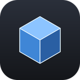
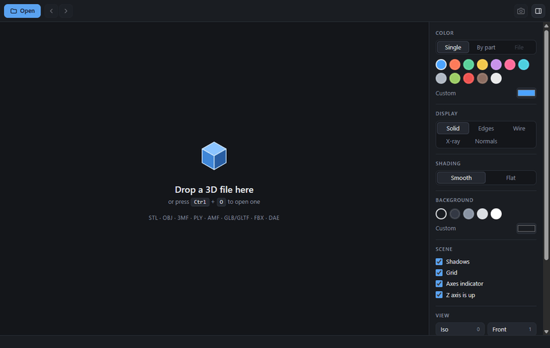
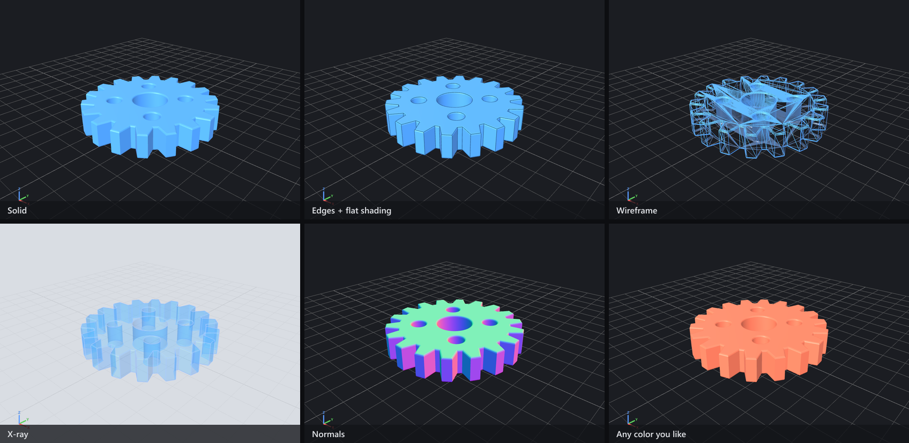
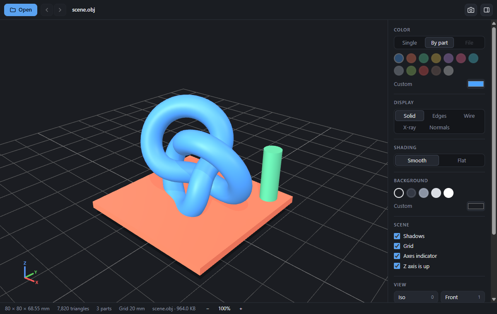
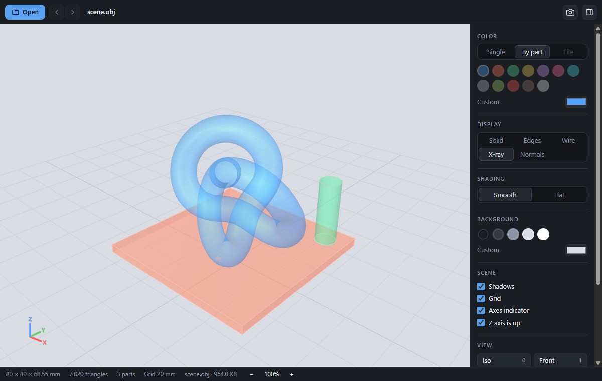

<div align="center">



# Simple 3D Viewer

**A small, fast, offline viewer for 3D-print files.**<br>
Open an STL, OBJ or 3MF, spin it around, and use color and shading to see its shape clearly.

[](https://github.com/NickyVerslycken/Simple-3D-Viewer/releases/latest)
[](LICENSE)
[](#download)
[](https://github.com/NickyVerslycken/Simple-3D-Viewer/releases)

[**Download**](#download) · [How to use](#how-to-use) · [Formats](#supported-formats) · [Build from source](#build-from-source) · [License](#license)

<br>



</div>

<br>

## Why

I wanted the simple 3D viewer that older versions of Windows had: it just opened a model and let you look at it. Simple 3D Viewer brings that
idea back and makes it work on Windows, macOS and Linux. Double-click a file, look at it from every side, done. No account, no cloud,
no internet connection, no slicer needed.

## Features

- **Opens the formats slicers use:** STL (binary and ASCII), OBJ (+ MTL colors), 3MF, PLY, AMF, plus GLB/glTF, FBX and Collada.
- **Turn it any direction:** free rotation (no "stuck at the poles"), pan, mouse-wheel zoom, and one-key standard views (front, back, left, right, top, bottom, isometric).
- **Zoom with a readout:** `−` / `+` buttons and keys, with the level shown as a percentage (100% = model fits the window).
- **Colors that help you tell shapes apart:** one color of your choice, a different color per part, or the colors stored in the file.
- **Display modes:** solid, edges, wireframe, x-ray and normals, with smooth or flat shading.
- **Real dimensions:** size in mm, triangle count, a measured grid and an axis indicator. The Z axis is up, like in a slicer.
- **Browse a folder:** step through the models in the same folder with the arrow keys.
- **Screenshots:** save the current view as a PNG.
- **Private:** works fully offline and sends nothing anywhere.
- **Native feel:** a proper installer, file associations ("Open with…"), drag and drop, and a dark UI that stays out of the way.

## Download

> **Always get the files from the [Releases page](https://github.com/NickyVerslycken/Simple-3D-Viewer/releases/latest)** and check the checksum (see [Verify your download](#verify-your-download)).

| Platform | Download | Notes |
| --- | --- | --- |
| **Windows** 10 / 11 (64-bit) | [**Simple-3D-Viewer-Windows-Setup.exe**](https://github.com/NickyVerslycken/Simple-3D-Viewer/releases/latest/download/Simple-3D-Viewer-Windows-Setup.exe) | Installer for the current user. No admin rights needed. **Recommended.** |
| | [Simple-3D-Viewer-Windows.msi](https://github.com/NickyVerslycken/Simple-3D-Viewer/releases/latest/download/Simple-3D-Viewer-Windows.msi) | Per-machine installer, for managed or company PCs. |
| **macOS** (Apple silicon and Intel) | [**Simple-3D-Viewer-macOS.dmg**](https://github.com/NickyVerslycken/Simple-3D-Viewer/releases/latest/download/Simple-3D-Viewer-macOS.dmg) | One universal disk image for both processor types. |
| **Linux** (x64) | [**Simple-3D-Viewer-Linux.AppImage**](https://github.com/NickyVerslycken/Simple-3D-Viewer/releases/latest/download/Simple-3D-Viewer-Linux.AppImage) | Runs on most distributions, nothing to install. |
| | [Simple-3D-Viewer-Linux.deb](https://github.com/NickyVerslycken/Simple-3D-Viewer/releases/latest/download/Simple-3D-Viewer-Linux.deb) | For Debian, Ubuntu and derivatives. Registers the file types. |

Checksums: [SHA256SUMS-windows.txt](https://github.com/NickyVerslycken/Simple-3D-Viewer/releases/latest/download/SHA256SUMS-windows.txt) · [SHA256SUMS-macos.txt](https://github.com/NickyVerslycken/Simple-3D-Viewer/releases/latest/download/SHA256SUMS-macos.txt) · [SHA256SUMS-linux.txt](https://github.com/NickyVerslycken/Simple-3D-Viewer/releases/latest/download/SHA256SUMS-linux.txt)

### Install

<details>
<summary><b>Windows</b></summary>

1. Download and run `Simple-3D-Viewer-Windows-Setup.exe`.
2. The installers are **not code-signed** yet, so Windows SmartScreen may say *"Windows protected your PC"*. Click **More info → Run anyway**.
3. Follow the wizard. Start Menu and desktop shortcuts are created.

</details>

<details>
<summary><b>macOS</b></summary>

1. Open `Simple-3D-Viewer-macOS.dmg` and drag **Simple 3D Viewer** to **Applications**.
2. The app is **not notarized** yet. The first time, right-click the app and choose **Open**, then **Open** again.
   If macOS says the app is damaged, run this once in Terminal and try again:
   ```bash
   xattr -dr com.apple.quarantine "/Applications/Simple 3D Viewer.app"
   ```

</details>

<details>
<summary><b>Linux</b></summary>

```bash
chmod +x Simple-3D-Viewer-Linux.AppImage && ./Simple-3D-Viewer-Linux.AppImage
# or
sudo apt install ./Simple-3D-Viewer-Linux.deb
```

If the AppImage does not start on a recent distribution that restricts unprivileged user namespaces (for example Ubuntu 24.04),
start it with `./Simple-3D-Viewer-Linux.AppImage --no-sandbox`, or use the `.deb`.

</details>

### Make it your default 3D viewer

An installer can register the file types, but Windows and macOS require **you** to confirm the default:

- **Windows:** right-click a `.stl` file → **Open with** → **Choose another app** → **Simple 3D Viewer** → tick **Always use this app**. Repeat for `.obj`, `.3mf`, …
  Or use **Settings → Apps → Default apps**.
- **macOS:** select a file, press `⌘ I` (Get Info) → **Open with** → **Simple 3D Viewer** → **Change All…**
- **Linux:** right-click → **Open With** → **Set as default** (the `.deb` registers the MIME types).

### Verify your download

Each release contains `SHA256SUMS-<platform>.txt`. Compare the hash of your download with it (GitHub also shows a SHA-256 digest next to every release file).

**Windows (PowerShell):**

```powershell
Get-FileHash .\Simple-3D-Viewer-Windows-Setup.exe -Algorithm SHA256
```

**macOS / Linux:**

```bash
shasum -a 256 Simple-3D-Viewer-macOS.dmg     # macOS
sha256sum   Simple-3D-Viewer-Linux.AppImage  # Linux
```

Or check against the whole file in one go (put the download and the checksum file in the same folder):

```bash
sha256sum -c --ignore-missing SHA256SUMS-windows.txt        # Linux / Git Bash
shasum -a 256 -c --ignore-missing SHA256SUMS-macos.txt      # macOS
```

The two values must be identical. If they are not, do not run the file.

## How to use

**Open a model:** drag it onto the window, press `Ctrl/⌘ + O`, click **Open**, or double-click a model file once the app is your default.

| Action | Mouse | Keyboard |
| --- | --- | --- |
| Rotate | left-drag | |
| Pan | right-drag | |
| Zoom | mouse wheel, or middle-drag | `+` / `-` · `Ctrl/⌘ +` / `Ctrl/⌘ -` · buttons at the bottom right |
| Reset zoom to 100% | click the percentage | `Ctrl/⌘ + 0` |
| Fit the model to the window | | `F` |
| Standard views | **View** buttons in the side panel | `0` iso · `1` front · `2` back · `3` left · `4` right · `5` top · `6` bottom |
| Previous / next model in the folder | `‹` `›` buttons | `←` `→` |
| Save a screenshot (PNG) | camera button | `P` |
| Hide / show the side panel | panel button | `Tab` |

### Make shapes easier to tell apart

<p align="center"></p>

| Setting | What it does |
| --- | --- |
| **Color: Single** | Paints everything in the color you pick. |
| **Color: By part** | Gives every separate part of the file its own color, ideal for assemblies and multi-part plates. |
| **Color: File** | Uses the colors stored in the file (OBJ materials, 3MF, PLY vertex colors, glTF, …). Disabled when the file has none. |
| **Display: Solid / Edges / Wire / X-ray / Normals** | Edges outlines sharp edges, X-ray lets you see through to hidden shapes, and Normals colors surfaces by the direction they face. |
| **Shading: Smooth / Flat** | Smooth rounds curved surfaces but keeps hard edges crisp. Flat shows every triangle, useful for checking mesh quality. |
| **Background** | Pick a dark, gray or light background, or any custom color. |
| **Shadows · Grid · Axes** | Toggle the ground shadow, the measured grid (cell size in the status bar) and the XYZ indicator. |
| **Z axis is up** | On by default for STL, OBJ, 3MF, PLY and AMF (how slicers see them). Turn it off if a model lies on its side. Remembered per file type. |

<p align="center">
  
  
</p>

Your settings are remembered between sessions.

## Supported formats

| Format | Extensions | Colors / materials | Notes |
| --- | --- | --- | --- |
| STL | `.stl` | vertex colors (non-standard extension) | Binary and ASCII |
| OBJ | `.obj` (+ `.mtl`) | material colors | Textures are not loaded. Keep the `.mtl` next to the `.obj`. |
| 3MF | `.3mf` | colors and materials | Multi-object plates |
| PLY | `.ply` | vertex colors | Meshes and point clouds |
| AMF | `.amf` | colors and materials | |
| glTF / GLB | `.glb`, `.gltf` | PBR materials | Draco/Meshopt-compressed files are not supported yet |
| FBX | `.fbx` | materials | |
| Collada | `.dae` | materials | |

STEP / IGES (CAD) and slicer project files (`.gcode`, `.3mf` with only settings) are not supported.

## Privacy

Everything happens on your computer. The app has no network features, no telemetry and no accounts. It only reads the file you open
(and the `.mtl` / textures next to it), and it only writes a PNG if you ask for a screenshot.

## Build from source

Requires [Node.js](https://nodejs.org) 20 or newer.

```bash
git clone https://github.com/NickyVerslycken/Simple-3D-Viewer.git
cd Simple-3D-Viewer
npm install
node node_modules/electron/install.js   # only needed with npm 11+, which blocks install scripts
npm start                               # run the app
```

```bash
npm run dist:win      # Windows: .exe + .msi   → release/
npm run dist:mac      # macOS:   universal .dmg (run on a Mac)
npm run dist:linux    # Linux:   AppImage + .deb (run on Linux or WSL)
npm run smoke         # render every sample format → test/out/*.png
```

Installers can only be built on their own operating system. The [Release workflow](.github/workflows/release.yml) builds them on GitHub for you.
Details are in [docs/RELEASING.md](docs/RELEASING.md).

**How it works:** a small [Electron](https://www.electronjs.org) shell (`src/main`) and a [three.js](https://threejs.org) viewer (`src/renderer`).
Electron gives native installers and file associations on every OS from one codebase, and three.js has well-tested loaders for the 3D formats.

## Contributing

Bug reports, ideas and pull requests are welcome. Please read [CONTRIBUTING.md](CONTRIBUTING.md) first and follow the [Code of Conduct](CODE_OF_CONDUCT.md).
To report a security problem privately, see [SECURITY.md](SECURITY.md).

## License

Copyright © 2026 [Nicky Verslycken](https://github.com/NickyVerslycken). Licensed under the **[PolyForm Shield License 1.0.0](LICENSE)**.

In plain words (the [license text](LICENSE) is what counts):

- ✅ **Free for everyone, including companies**, to use, copy, change and share.
- ✅ Use it at home, at school, at work, in a print shop.
- ❌ You may **not** use it to provide a product that **competes** with it. That means you can't sell it, sell a modified version, or release it as a competing viewer, even for free.
- 📝 Anyone who passes the software on must include the license and the `Required Notice:` line with the author's name (it is at the top of the [LICENSE](LICENSE) file).

If you show or write about the app, a link back to this project is much appreciated.

This is a "source-available" license, not an OSI-approved open-source license, because it limits competing use.
Third-party components keep their own licenses, see [THIRD-PARTY-NOTICES.md](THIRD-PARTY-NOTICES.md).
